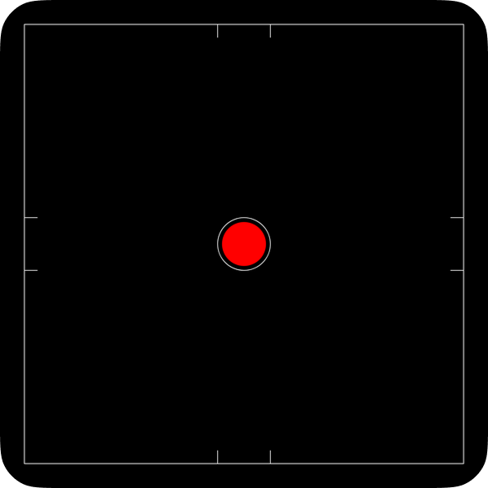

# Vaservaga

An ultra-lightweight bubble level app for Android.

[![Google Play Version][badge-version]][google-play]
[![Google Play Installs][badge-installs]][google-play]
[![APK Size][badge-size]][releases]
[![Min SDK][badge-minsdk]][android-sdk]

## Overview

Vaservaga is a minimal open-source bubble level app.
It measures surface level with the device gravity sensor.
The project goal is functional utility in an extremely small APK.

## Features

- **Ultra-small footprint**: APK size is approximately 11 KB.
- **Zero bloat**: No external dependencies or background services.
- **Smooth rendering**: Custom 2D canvas view for bubble motion.
- **Privacy-friendly**: No runtime permissions or network access required.

## Requirements

- Android 7.0 (API 24) or newer.
- Device with a gravity sensor.

## Install

Install from [Google Play][google-play] or download the APK from [Releases][releases].

[badge-version]: https://img.shields.io/badge/dynamic/json?url=https%3A%2F%2Fplaybadges.pavi2410.com%2Fapp%2Fdetails%3Fid%3Dcom.whitipet.vaservaga&query=%24.version&prefix=v&label=version&color=3ddc84&logo=google-play&logoColor=white
[badge-installs]: https://img.shields.io/endpoint?color=3ddc84&logo=google-play&logoColor=white&url=https%3A%2F%2Fplay.cuzi.workers.dev%2Fplay%3Fi%3Dcom.whitipet.vaservaga%26l%3Dinstalls%26m%3D%24totalinstalls
[badge-size]: https://img.shields.io/badge/APK%20size-~11%20KB-3ddc84?logo=android&logoColor=white
[badge-minsdk]: https://img.shields.io/badge/minSdk-24-blue?logo=android&logoColor=white
[releases]: https://github.com/whitipet/vaservaga-android/releases
[google-play]: https://play.google.com/store/apps/details?id=com.whitipet.vaservaga
[android-sdk]: https://developer.android.com/about/dashboards